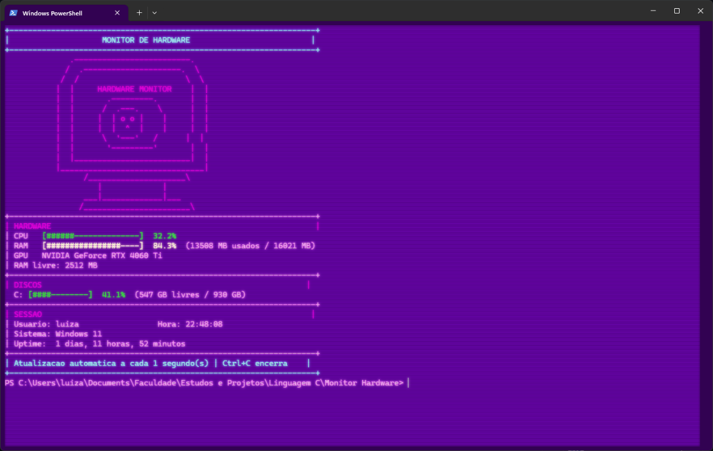

# Monitor de Hardware

Monitor de hardware desenvolvido em C para Windows, utilizando a Windows API. O programa apresenta informações do computador em tempo real diretamente no terminal, com um painel colorido, barras de progresso e arte ASCII.

## Demonstração



## Recursos

- Monitoramento do uso da CPU
- Monitoramento do uso da memória RAM
- Memória total, usada e livre
- Identificação da GPU
- Uso e espaço disponível dos discos locais
- Nome da versão do Windows
- Usuário atual e horário
- Tempo de atividade do computador (uptime)
- Atualização automática a cada segundo
- Barras visuais e cores de alerta no terminal
- Desenho ASCII de um monitor

## Requisitos

- Windows 10 ou Windows 11
- Visual Studio com as ferramentas de desenvolvimento em C
- Developer Command Prompt for Visual Studio

## Como compilar

Abra o **Developer Command Prompt for Visual Studio** e navegue até a pasta do projeto:

```cmd
cd /d "C:\Users\luiza\Documents\Faculdade\Estudos e Projetos\Linguagem C\Monitor Hardware"
```

Compile o programa com:

```cmd
cl monitorhardware.c /Fe:monitorhardware.exe user32.lib advapi32.lib
```

## Como executar

Depois da compilação, execute:

```cmd
monitorhardware.exe
```

Para encerrar o monitor:

```text
Ctrl + C
```

## Organização do projeto

```text
.
├── monitorhardware.c
├── assets/
│   └── monitor-hardware.png
└── README.md
```

Os arquivos gerados pela compilação, como `.exe`, `.obj`, `.pdb` e `.ilk`, são ignorados pelo Git e não precisam ser enviados ao repositório.

## APIs utilizadas

- `GetSystemTimes`: cálculo do uso da CPU
- `GlobalMemoryStatusEx`: informações da memória RAM
- `EnumDisplayDevicesA`: identificação da GPU
- `GetDiskFreeSpaceExA`: informações dos discos
- `GetTickCount64`: tempo de atividade do sistema
- Registro do Windows: identificação da versão do sistema operacional

## Licença

Projeto acadêmico e experimental, desenvolvido para estudos de linguagem C e da Windows API.
